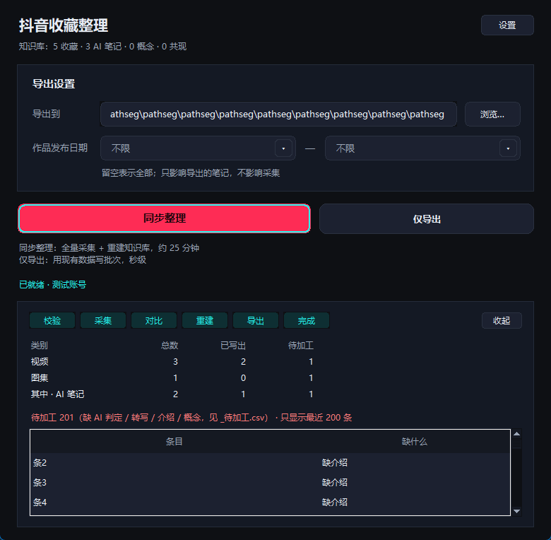
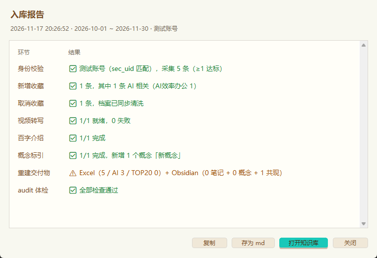

<div align="center">

# 抖音收藏整理

**把抖音收藏整理成可检索的知识库与一批可带走的交付文件**

采集 · 账号硬校验 · 增量对比 · 两级分类 · Excel/CSV · Obsidian · 体检 · 入库报告


[下载安装](#下载安装) · [操作说明](#操作说明) · [工程说明](docs/工程说明.md) · [问题反馈](https://github.com/shaoboqian-arch/douyin-ai-knowledge-client/issues)

</div>

---

## 项目简介

抖音收藏整理是一款 Windows 桌面客户端。选好交付目录和发布时间范围，点一次按钮，即可完成
「采集收藏 → 对比新增 → 重建 Excel/CSV → 重建 Obsidian 知识库 → 体检 → 写出交付批次」。

界面常驻只有四项：交付目录、发布时间范围、开始整理、状态行。每轮新建带时间戳的批次目录，
**绝不覆盖已有文件**。

它不是一个独立的采集器：采集与重建调用你本机已有的抖音项目（TikTokDownloader 二次开发版）
及其 `.venv`，客户端只负责编排、门禁与交付。**Cookie 不复制、不上传**，仍留在原项目里。

## 主要功能

### 🚀 两个动作，不混淆

- **同步整理**：校验 → 全量采集 → 对比 → 重建 → 导出，阶段实时高亮；采集时按页显示进度
- **仅导出**：用项目里已有的数据直接写批次，不联网、不重新采集
- 日期下方实时显示「范围内 N 条」；范围 0 条时同步会二次确认，仅导出直接提示

### 🛡️ 两道硬门禁

- **账号**：采集日志里的 `sec_uid` 必须等于你「采用」的账号，不符立即中止
- **条数**：低于设置里的下限立即中止（可在设置中配置，示例为 1000）
- 两种情况下都**不重建交付物**，批次里只留日志与状态，避免用错数据覆盖知识库

### 🧭 两级分类

一级沿用客户端化之前的 7 个 AI 类别，不重算；二级新增子类别：

- **AI 相关**：开源项目与免费资源 · Skill 类 · Skill 与 Agent 用法 · 提示词与模板 ·
  教程与实操 · 工具测评与选型 · 行业资讯与观点 · 原理与科普 · 变现与商业
- **非 AI**：知识科普 · 影视与动漫 · 娱乐与游戏 · 音乐与才艺 · 美食 · 旅行与城市 ·
  健身运动 · 数码与工具 · 手工与创作 · 职场与财经 · 情感与成长 · 健康与养生 · 生活记录

判定是确定性规则（标题 + 话题 + 归纳 + 介绍 + 转写节选），不调用模型；命中词写进清单的
「子类别依据」列，可逐条复核。上游若已写「子类别」，一律优先采用。

### 🗂️ 批次交付

```
export-<范围>-<时间戳>/
├─ 01_AI笔记/<AI类别>/<子类别>/<序号>_<发布日>_<类型>_<作者>_<标题>.md
├─ 02_其他收藏/<子类别>/
├─ 03_待判定/
├─ _导出清单.csv      范围内每条一行（含子类别、依据、核心内容、介绍、概念、链接）
├─ _导出报告.csv      每个写出文件一行（字节数、状态）
├─ _待加工.csv        还需要外部 AI 加工的条目与缺哪一步
├─ _入库报告.md/.json 本轮整理结果（8 个环节）
├─ _导出说明.txt
└─ _整理状态.json     阶段、计数、日志路径（不含 Cookie）
```

### 📚 Obsidian 知识库对接（可选）

- 自动检测 Obsidian 安装位置与已打开的库（读 `%APPDATA%\obsidian\obsidian.json`）
- 设置里可开关「整理后重建 Obsidian 知识库」；没装 Obsidian 时开关禁用，
  Excel 与批次交付照常可用
- 开启后仍调用原项目的 `gen_obsidian.py` → `audit_obsidian.py`，笔记、概念、图谱与体检口径不变
- 设置页直接显示库现状：收藏 / AI / 概念 / 共现；「打开知识库」用 `obsidian://` 唤起

### 📊 入库报告

每轮整理生成 `_入库报告.md` 与 `_入库报告.json`，界面按同一份 JSON 渲染：

| 环节 | 口径 |
|---|---|
| 身份校验 | 账号 + `sec_uid` 匹配 + 采集条数是否达下限 |
| 新增收藏 | `raw` 与上一版快照的作品 ID 差集，AI/非 AI/待判定拆分 |
| 取消收藏 | 差集反方向，档案是否同步清洗 |
| 视频转写 | 新 AI 视频的转写稿就绪数 |
| 百字介绍 | 新 AI 条目的介绍就绪数 |
| 概念标引 | 就绪数 + 本轮新增概念 |
| 重建交付物 | Excel（总/AI/TOP20）+ Obsidian（笔记/概念/共现） |
| audit 体检 | `audit_obsidian.py` 结论 |

### 🔁 断点续跑

采集成功但重建/导出失败（例如知识库体检不通过）时，点「续跑」只重跑重建与导出，
**不重新采集**；结果写成新批次，旧批次保留为证据。

### 🔑 本机初始化

自动发现项目目录、`.venv` 解释器与知识库目录；从 `probe_account.py` 读出当前 Cookie 的账号，
确认后写入设置。三项就绪后主按钮才从「初始化本机环境」变成「开始整理」。

### 🔌 可选 MCP

同一套能力可通过 MCP stdio 调用：`dy_status` / `dy_preflight` / `dy_export` / `dy_sync` /
`dy_retry` / `dy_report`。设置页可复制配置、合并写入并测试握手。

## 界面





## 技术栈

| 层级 | 技术选型 |
|:---:|:---|
| 语言与界面 | Python 3.12 + Tkinter 自绘（深色 + 抖音品牌色） |
| 打包 | PyInstaller 单文件 exe |
| 编排 | 子进程流式读日志 + 事件驱动进度 |
| 协议 | 本地 MCP stdio（可选） |

## 下载安装

当前版本 **V0.1.3**。前往 [Releases](https://github.com/shaoboqian-arch/douyin-ai-knowledge-client/releases/latest) 下载：

| 安装包 | 说明 |
|:---|:---|
| `*-Setup-V0.1.3.exe` | 创建快捷方式与卸载项，默认装到 `%LOCALAPPDATA%\抖音收藏整理`，不需要管理员权限 |
| `*-V0.1.3-portable.zip` | 解压后双击即用，不写注册表 |

**前置条件**

1. 本机已有可运行的抖音采集项目：含 `extract_favorites.py`、`.venv`、`Volume/settings.json`（已登录 Cookie）
2. 该项目已产出 `work/rows_merged.json` 与一个 Obsidian 知识库目录（含 `00_入口.md`）；没有知识库时可关掉重建
3. Windows，无需管理员权限

## 操作说明

### 基本使用

1. 双击打开「抖音收藏整理」
2. 首次运行点主按钮「初始化本机环境」：项目目录 → 校验账号并采用 → 知识库（可跳过）
3. 在「导出设置」里选导出目录、作品发布日期（**留空 = 全部**，起止都含当天）
4. 点「同步整理」：全量采集后重建知识库，再导出所选范围；只想用现有数据出批次时点「仅导出」
5. 完成后点「打开」进入批次目录；点「入库报告」看本轮结果；待加工条目按 `_待加工.csv` 补齐后重新同步

### 命令行（可选）

```bat
抖音收藏整理.exe --cli --status
抖音收藏整理.exe --cli --preflight --from 2026-10-01 --to 2026-11-17
抖音收藏整理.exe --cli --export --dest "D:\交付" --from 2026-10-01 --to 2026-11-17
抖音收藏整理.exe --cli --sync --dest "D:\交付"
抖音收藏整理.exe --cli --report --batch "D:\交付\export-示例范围-示例批次"
```

### MCP 接入

把这一键合并进 `~/.workbuddy/mcp.json` 已有的 `mcpServers`（不要整份覆盖），`command` 换成本机 exe 路径：

```json
{
  "mcpServers": {
    "douyin-fav-sync": {
      "type": "stdio",
      "command": "<安装目录>\\抖音收藏整理.exe",
      "args": ["--mcp"],
      "description": "抖音收藏采集与知识库整理"
    }
  }
}
```

保存后到连接器管理 → 自定义连接器 → 对服务点「信任」；调用 `dy_status` 返回 `ready: true` 即接通。

## 使用边界

- 只读本机项目数据；不访问其它服务、不上传任何内容
- 采集约 25 分钟，期间可点「停止」中止；已采集的原始数据保留，但不生成交付
- **不做 AI 判定 / 转写 / 百字介绍 / 概念标引**：这四项属外部加工，客户端只统计缺口
- 账号或条数不符时一定中止：宁可这一轮没有交付，也不让错账号的数据进知识库
- Cookie 始终在抖音项目的 `Volume/settings.json` 里，客户端设置文件中没有它

## 开发指南

```bash
python build/build.py          # 构建 dist/Setup + 便携 zip
python tests/run_all.py 轮次名   # 12 步全量复检
```

版本号唯一真源是 `src/common.py` 的 `VERSION`。发版前必须 11/11 PASS，且
`tests/verify_public_safe.py` 通过（本机敏感词名单 `tests/public_safe.local.txt` 不进 Git，
参考 `tests/public_safe.local.example.txt`）。

工程细节、版本记录与复检口径见 [docs/工程说明.md](docs/工程说明.md)。

## 项目结构

```
douyin-ai-knowledge-client/
├── src/       界面、编排、两级分类、交付、入库报告、MCP、安装器
├── build/     构建脚本、图标、隔离依赖
├── tests/     12 步复检（离线夹具 + 真实数据只读回归）
├── docs/      工程说明与界面截图
└── dist/      构建产物（exe / zip 不进 Git，走 Releases）
```

## 许可证

本仓库暂未选定许可证，选定后补上。
